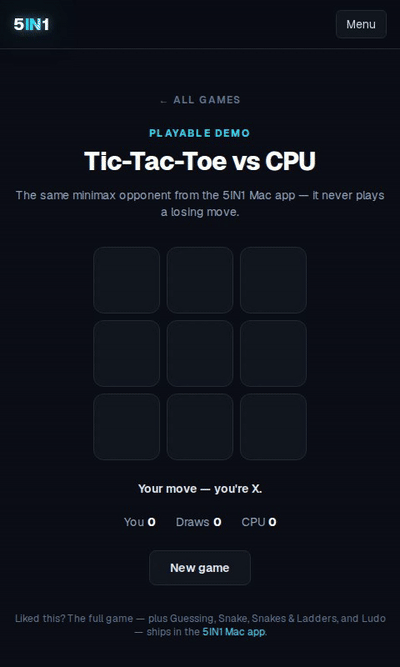

# 5IN1

**Five games. Every platform. One codebase.**

Play now: https://m4ster-5in1.vercel.app/play

[](https://m4ster-5in1.vercel.app)
[](https://github.com/m4sternoob/m4ster-5in1-web/releases)
[](https://github.com/m4sternoob/m4ster-5in1-web/releases)
[](https://github.com/m4sternoob/m4ster-5in1-web/releases)
[](https://github.com/m4sternoob/m4ster-5in1-web/releases)

5IN1 is five classic games in one app — Snake, Connect 4, Memory Match, Tic-Tac-Toe, and Number Guessing — with an alive UI that breathes, glows, and pops. Change one thing, and every platform gets it.

## Gameplay

### Snake

The classic, with speeds, wrap walls, and golden food — smooth gliding, glowing head, particle bursts.

### Connect 4

Drop discs, line up four — the CPU blocks and takes wins on Hard. Gravity drops, win celebrations, confetti.

### Memory Match

Flip cards, find pairs. Easy, Medium, Hard difficulties with move tracking.

### Tic-Tac-Toe

You vs the CPU. Clean, fast, satisfying.

### Number Guessing

The original — guess the number, get hints, beat your best.

## One codebase, all platforms

| Platform | How | Trigger |
|----------|-----|---------|
| Web | Vercel | Auto-deploy on push |
| Windows (.exe) | Tauri (Rust) | `v*` release tag |
| macOS (.dmg) | Tauri (Rust) | `v*` release tag |
| Android (.apk) | Capacitor | `v*` release tag |
| iOS (.ipa) | Capacitor | `v*` release tag |

**Change once, push everywhere.** The web app is the single source of truth. Tauri wraps it for desktop, Capacitor wraps it for mobile. Same UI, same animations, one-to-one identical — like Fortnite on every device.

See [DESIGN_SYSTEM.md](DESIGN_SYSTEM.md) for the cross-platform design tokens.

## Tech stack

- **Framework:** Next.js (App Router) + TypeScript + Tailwind CSS
- **Desktop:** Tauri v2 (Rust backend)
- **Mobile:** Capacitor 8
- **UI:** Alive design system — breathing logo, mouse-reactive grid, aura backgrounds, staggered pop-ins
- **Hosting:** Vercel

## Run it locally

Requires Node.js 20+.

```bash
npm install
npm run dev      # dev server at http://localhost:3000
```

## Production build

```bash
npm run build    # static export to out/
npm run start    # serve the production build locally
```

## Releases

Push a `v*` tag to trigger all platform builds:

```bash
git tag v1.0.0
git push origin v1.0.0
```

This runs:
- **Tauri Build** → Windows `.exe` (NSIS) + macOS `.dmg`
- **Capacitor Android** → debug + release `.apk`

Artifacts attach to the GitHub release automatically.

## Notes

- Contact: xyaz@gmail.com
- The `/play` routes are the full games — not demos, the real thing.
- Free and open-source. No accounts, no tracking, offline-friendly.
